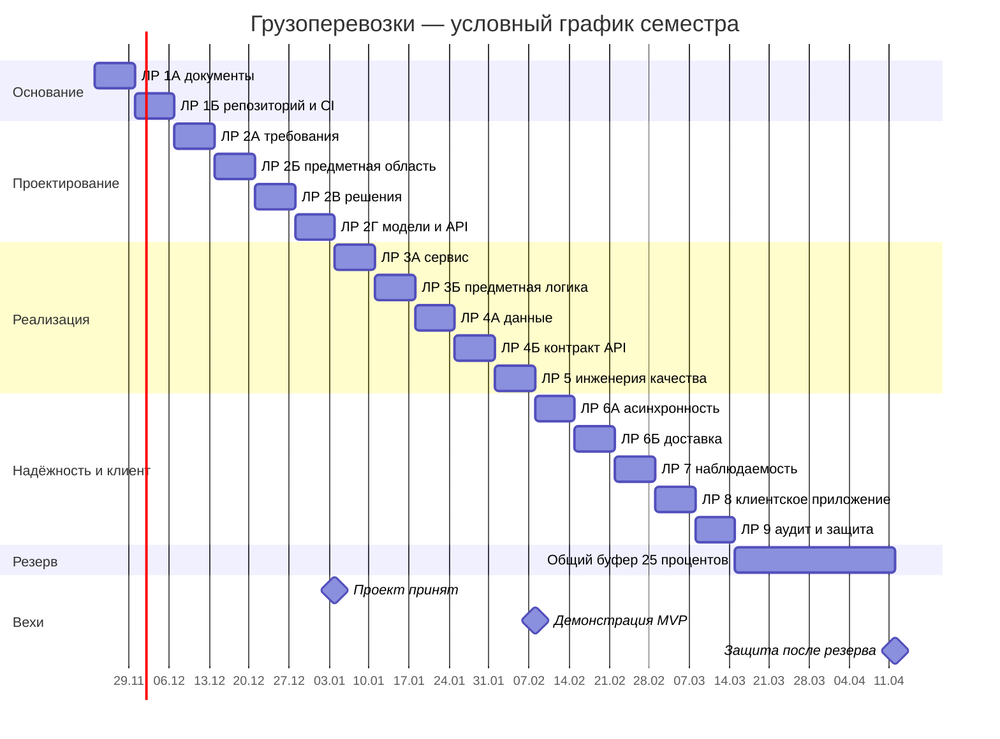

# План семестра — диаграмма Ганта

## Контрольные точки

| Точка | Учебный ориентир | Что должно быть проверяемо |
|---|---|---|
| Принята ЛР 1А | конец недели 1 | Семь документов, домен, MVP и процесс |
| Готова ЛР 1Б | конец недели 2 | GitHub, защита `main`, CI и ревью |
| Спроектирована система | конец недели 6 | Требования, модели, решения и интерфейсы API |
| Сервис запускается | конец недели 7 | Воспроизводимое окружение |
| Сквозной MVP протестирован | конец недели 11 | Груз → заявка → тестовая оплата → назначение → статусы → подтверждение и выплата |
| Клиент и защита | конец недели 16 | Веб + Android, обоснование решений, итоги тестирования |

## Зависимости, метод оценки и буфер

- Зависимость этапов: требования → модель домена → технические решения → сервис → данные/API → тесты → асинхронность/доставка → клиенты и защита. Внутри этапов разрешено вести параллельные вертикальные срезы.
- **План от цели**, а не подтверждённый прогноз по производительности команды.
- **Буфер 25%** от 16 условных недель основных этапов = 4 недели, выделен отдельно. На практике часть резерва будет использована раньше; затраты фиксируются в CHANGELOG и обсуждаются командой.
- Нет официальных сроков сдачи: после получения календаря преподавателя обновить условную ось, не выдавая текущую за утверждённую.
