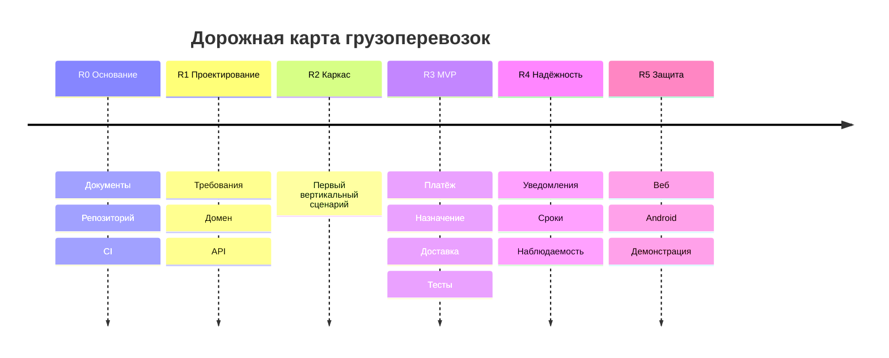

# Дорожная карта «Грузоперевозки»

| Веха | Модули | Измеримый результат |
|---|---|---|
| **R0. Основание** | М01–М02 | Семь документов, репозиторий, правила PR и CI |
| **R1. Проектирование** | М03–М06 | Уточнённые функциональные/NFR требования, модель домена, архитектура, спецификации интерфейсов/API и платёжные ограничения |
| **R2. Каркас** | М07–М08 | Запускаемые сервис и клиентский каркас; первый вертикальный путь создания заявки с демонстрационными тарифами |
| **R3. MVP** | М09–М11 | Данные и миграции, контракт API, полная демонстрация бронирования ресурса, оформления, тестовой оплаты, назначения, статусов, подтверждения, тестовой выплаты и тесты |
| **R4. Надёжность** | М12–М14 | Асинхронные уведомления, защитные сценарии сроков/споров, доставка и наблюдаемость |
| **R5. Клиент и защита** | М15–М17 | Веб-интерфейсы ролей, Android-взаимодействие водителя, аудит и демонстрация согласованного MVP |

